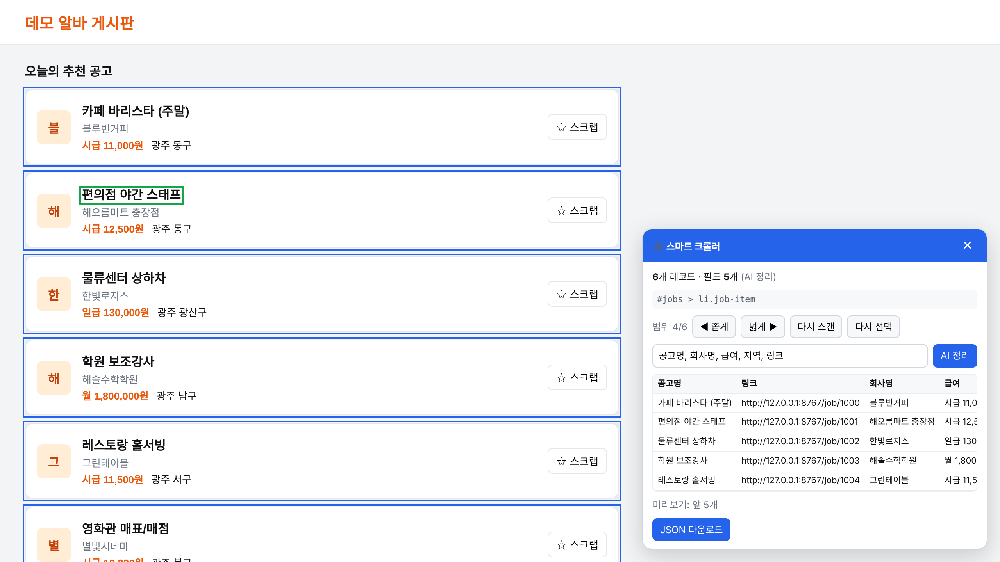
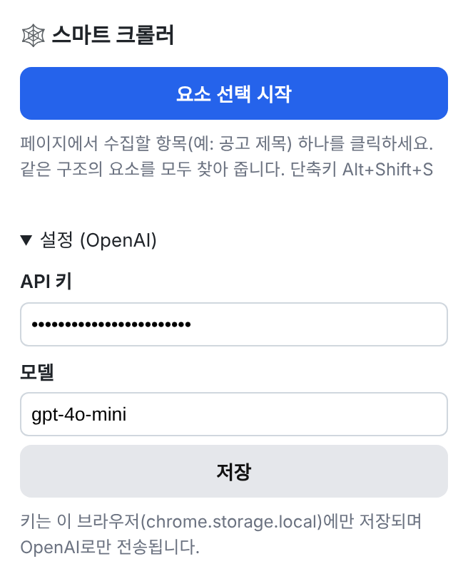
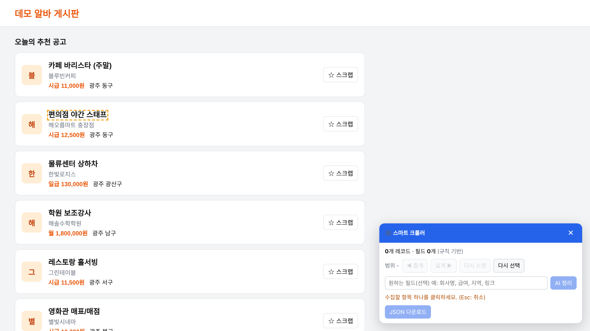
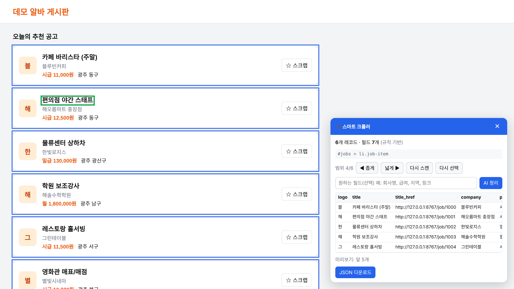

# 🕸️ 스마트 크롤러 (Chrome 확장 프로그램)

> 웹페이지에서 **항목 하나를 클릭**하면 **같은 구조의 항목을 전부 찾아 수집**하고,
> **OpenAI가 필드 이름을 정리**해 **JSON으로 내보내는** 크롤링 도구입니다.



- 코드 작성 없이 클릭만으로 목록 데이터(채용 공고, 상품, 게시글, 표 등) 수집
- 비슷한 요소 찾기는 **규칙 기반이라 AI 없이도 즉시·무료로** 동작
- AI는 필드 정리에만 쓰여 **수집 1회당 API 호출 1~2번**으로 비용 최소화

---

## 목차
1. [업무 배경](#1-업무-배경)
2. [분석 및 방향성](#2-분석-및-방향성)
3. [결과물](#3-결과물) — 설치 · API 키 설정 · 사용 방법 · 사용 결과
4. [향후 계획](#4-향후-계획)

---

## 1. 업무 배경
Python 크롤러(Playwright 기반)로 사이트 전체를 수집할 수는 있었습니다. 하지만 "이 목록의 이 항목들만" 뽑으려면 매번 CSS 셀렉터를 직접 분석해서 코드를 고쳐야 했습니다.
그래서 **브라우저에서 원하는 요소를 클릭하기만 하면** 비슷한 요소를 모두 모아 주고, **AI가 데이터 이름까지 정리**해 주는 확장 프로그램으로 발전시켰습니다.

## 2. 분석 및 방향성

### 비슷한 요소 찾기 — 규칙 기반 (즉시·무료)
1. 클릭한 요소에서 부모 방향으로 올라가며, 각 단계마다 **같은 모양(태그+공통 클래스)의 형제가 몇 개 반복되는지** 셉니다.
2. 반복 수가 가장 많은 단계를 **레코드 1개(카드/행)** 로 판단하고, 그 구조의 CSS 셀렉터로 페이지 전체에서 같은 레코드를 모읍니다.
3. `active`, `selected` 같은 **상태 클래스는 무시**해서 선택된 항목도 같은 묶음으로 잡습니다.
4. 표의 셀을 클릭하면 **행(`tr`) 단위**로 수집하고, 머리글(`th`)을 열 이름으로 씁니다.
5. 레코드 안의 텍스트·링크(`href`)·이미지(`src`, `alt`)를 **구조 경로를 키**로 추출합니다. 예: `$>div.card>a.title`

### AI 필드 정리 — OpenAI (선택)
- 전체 데이터가 아닌 **샘플 6개와 HTML 일부만** 전송합니다.
- AI는 "어떤 원본 키를 어떤 이름의 필드로 묶을지"라는 **계획만** 돌려주고, 실제 적용은 브라우저에서 전체 레코드에 합니다. 그래서 레코드가 1,000개여도 호출은 1~2번입니다.
- AI가 레코드 범위가 잘못 잡혔다고 판단하면 더 나은 셀렉터를 제안합니다. 실제 페이지에서 2개 이상 검증된 경우에만 반영합니다.
- [Structured Outputs](https://developers.openai.com/api/docs/guides/structured-outputs)(JSON 스키마 강제)로 응답 형식 오류를 막았습니다.

### 보안
- API 키는 **이 브라우저의 로컬 저장소(`chrome.storage.local`)에만** 저장합니다.
- OpenAI 호출은 확장 프로그램의 **백그라운드(서비스 워커)에서만** 이루어지므로, 방문 중인 웹페이지에는 키가 노출되지 않습니다.

---

## 3. 결과물

### 3-1. 설치 (개발자 모드)
1. 이 저장소를 내려받습니다.
   ```bash
   git clone <이 저장소 URL>
   ```
   또는 GitHub의 **Code → Download ZIP**으로 내려받은 뒤 압축을 풉니다.
2. Chrome 주소창에 `chrome://extensions`를 입력합니다.
3. 오른쪽 위 **개발자 모드**를 켭니다.
4. **압축해제된 확장 프로그램을 로드합니다**를 누르고 `manifest.json`이 들어 있는 폴더를 선택합니다.
5. 툴바의 🧩(퍼즐) 아이콘 → **스마트 크롤러** 옆 📌를 눌러 고정합니다.

> Edge 브라우저도 `edge://extensions`에서 같은 방법으로 설치할 수 있습니다.

### 3-2. OpenAI API 키 설정
AI 정리 기능을 쓸 때만 필요합니다. 키가 없어도 **요소 수집과 JSON 다운로드는 그대로 동작**합니다.

1. **API 키 발급**
   1. [OpenAI Platform](https://platform.openai.com/)에 로그인합니다.
   2. 오른쪽 위 설정 → **API keys** → **Create new secret key**로 키를 만듭니다. 형식은 `sk-...`입니다.
   3. 키는 생성 직후에만 전체가 보이니 바로 복사해 둡니다.
   4. API 사용은 ChatGPT 구독과 별도로 **Billing에서 크레딧 충전**이 필요합니다.
2. **확장 프로그램에 입력**
   1. 툴바의 스마트 크롤러 아이콘을 클릭합니다.
   2. **▶ 설정 (OpenAI)** 을 펼칩니다.
   3. **API 키**에 복사한 키를 붙여넣습니다.
   4. **모델**은 기본값 `gpt-4o-mini`를 그대로 두거나, 사용할 모델명으로 바꿉니다.
   5. **저장**을 누르고 "저장했습니다." 문구가 뜨는지 확인합니다.



> ⚠️ API 키는 비밀번호와 같습니다. 코드·이슈·스크린샷에 키를 올리지 마세요. 노출됐다면 OpenAI Platform에서 즉시 삭제(Revoke)하고 새로 발급하세요.

### 3-3. 사용 방법

**① 선택 모드 시작**
수집할 페이지에서 확장 아이콘을 누르고 **요소 선택 시작**을 누릅니다(단축키 `Alt + Shift + S`).
마우스를 올리면 주황색 점선으로 요소가 표시됩니다.



**② 수집할 항목 하나 클릭**
공고 제목, 상품명처럼 수집하고 싶은 항목 하나를 클릭합니다.
- 클릭한 요소는 **초록 테두리**, 같은 구조로 찾은 레코드들은 **파란 테두리**로 표시됩니다.
- 오른쪽 아래 패널에 레코드 수, 셀렉터, 미리보기 표가 나타납니다.



**③ 범위 조정 (필요할 때만)**

| 버튼 | 설명 |
|---|---|
| ◀ 좁게 | 레코드 단위를 더 작게 (예: 카드 전체 → 카드 안의 제목 영역) |
| 넓게 ▶ | 레코드 단위를 더 크게 (예: 제목 → 카드 전체) |
| 다시 스캔 | 무한 스크롤로 항목을 더 불러온 뒤, 같은 셀렉터로 다시 수집 |
| 다시 선택 | 처음부터 다른 요소를 클릭 |

**④ AI 정리 (선택)**
입력란에 원하는 필드를 쉼표로 적고 **AI 정리**를 누릅니다.
예: `공고명, 회사명, 급여, 지역, 링크`
비워 두면 AI가 의미 있는 필드를 알아서 고릅니다. 버튼·광고 문구 같은 불필요한 값은 제외됩니다.

**⑤ JSON 다운로드**
**JSON 다운로드**를 누르면 `crawl_<사이트주소>_<날짜시간>.json` 파일이 저장됩니다.
패널은 ✕로 닫으면 페이지가 원래 상태로 돌아갑니다.

### 3-4. 사용 결과

**AI 정리 전 vs 후**

| 구분 | 필드 이름 | 내용 |
|---|---|---|
| 규칙 기반 (AI 없이) | `logo`, `title`, `title_href`, `company`, `pay`, `area`, `scrap` | HTML 클래스명을 그대로 사용, 버튼 문구 등 포함 |
| AI 정리 후 | `공고명`, `링크`, `회사명`, `급여`, `지역` | 요청한 필드만 한국어 이름으로 정리, 불필요한 값 제거 |

**다운로드된 JSON 예시** ([전체 파일](docs/sample-output.json))
```json
{
  "url": "https://demo-jobs.example/",
  "title": "데모 채용 게시판",
  "extracted_at": "2026-11-11T07:38:08.154Z",
  "record_selector": "#jobs > li.job-item",
  "mode": "AI 정리",
  "count": 6,
  "fields": [
    { "name": "공고명", "source_keys": ["$>div.card>div.info>a.title"], "type": "text" },
    { "name": "링크",   "source_keys": ["$>div.card>div.info>a.title@href"], "type": "url" },
    { "name": "회사명", "source_keys": ["$>div.card>div.info>p.company"], "type": "text" },
    { "name": "급여",   "source_keys": ["$>div.card>div.info>div.meta>span.pay"], "type": "text" },
    { "name": "지역",   "source_keys": ["$>div.card>div.info>div.meta>span.area"], "type": "text" }
  ],
  "records": [
    { "공고명": "카페 바리스타 (주말)", "링크": "https://demo-jobs.example/job/1000", "회사명": "블루빈커피", "급여": "시급 11,000원", "지역": "광주 동구" },
    { "공고명": "편의점 야간 스태프", "링크": "https://demo-jobs.example/job/1001", "회사명": "해오름마트 충장점", "급여": "시급 12,500원", "지역": "광주 동구" }
  ]
}
```

| 키 | 설명 |
|---|---|
| `record_selector` | 레코드를 찾은 CSS 셀렉터. Python 크롤러 등에 재사용 가능 |
| `mode` | `규칙 기반` 또는 `AI 정리` |
| `fields` | 필드 이름과 원본 위치(`source_keys`), 타입(text/number/url/date) |
| `records` | 실제 수집 데이터 |

**검증 내역**

| 테스트 | 결과 |
|---|---|
| JS로 늦게 그려지는 카드 목록(상태 클래스 `active` 포함) | 전체 레코드 감지, 누락 없음 |
| 표 셀 클릭 | 행 단위 수집, 머리글을 열 이름으로 사용, 머리글 행 자동 제외 |
| AI 정리 → JSON 다운로드 | 요청 필드로 정리되어 저장 |
| Chromium 확장 로드 | 서비스 워커 정상 등록 |
| 실제 사이트 | 정상 작동 확인 |

※ 스크린샷과 JSON 예시는 가상의 데모 페이지로 만든 것입니다.

### 파일 구성
```
├── manifest.json     # 확장 설정 (Manifest V3)
├── popup.html / .js  # 시작 버튼, API 키·모델 설정
├── content.js / .css # 요소 선택, 반복 구조 감지, 추출, 패널 UI, JSON 저장
├── background.js     # 스크립트 주입, OpenAI API 호출
└── docs/             # README용 스크린샷, 샘플 결과
```

### 문제 해결

| 증상 | 해결 |
|---|---|
| "이 페이지에서는 사용할 수 없습니다" | `chrome://` 페이지, 웹 스토어 등은 브라우저 정책상 확장 실행이 막혀 있습니다. 일반 웹페이지에서 사용하세요. |
| 레코드가 1개만 잡힘 / 너무 크게 잡힘 | **◀ 좁게 / 넓게 ▶** 로 범위를 조정하거나, 다른 요소(제목 등)를 다시 클릭하세요. |
| `OpenAI API 키가 없습니다` | 3-2 절차대로 키를 저장했는지 확인하세요. |
| `Incorrect API key` / `insufficient_quota` | 키가 틀렸거나 크레딧이 부족합니다. OpenAI Platform의 API keys·Billing을 확인하세요. |
| `model ... does not exist` | 설정의 모델명을 계정에서 사용 가능한 모델로 바꾸세요. |
| 무한 스크롤 항목이 덜 모임 | 끝까지 스크롤해 항목을 불러온 뒤 **다시 스캔**을 누르세요. |
| 코드 수정 후 반영이 안 됨 | `chrome://extensions`에서 새로고침(↻)한 뒤 페이지도 새로고침하세요. |

> 크롤링 전 대상 사이트의 이용약관과 robots.txt를 확인하고, 개인정보가 포함된 데이터는 수집·이용 범위에 주의하세요.

---

## 4. 향후 계획
- CSV / Excel 내보내기, 클립보드 복사
- '다음 페이지' 버튼을 지정해 여러 페이지 자동 수집
- 사이트별 선택 결과(셀렉터+필드 계획) 저장 → 재방문 시 원클릭 재수집
- `record_selector`를 Python 크롤러 설정으로 내보내 대량 수집과 연결

## 기술 스택
JavaScript · Chrome Extension Manifest V3 · Shadow DOM · OpenAI Chat Completions API (Structured Outputs)
